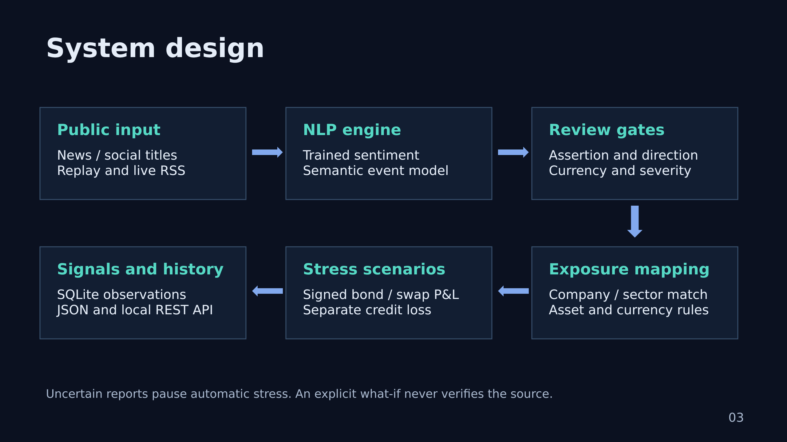

# Event-to-Exposure Risk Radar — S&P Global & Crisil Campus Hackathon

**Candidate Name:** VAIBHAVI CHATURVEDI
**College Email ID:** vaibhavi.mitmpl2024@learner.manipal.edu
**College / Campus:** Manipal Institute of Technology, Manipal
**Demo Video Link:** https://youtu.be/sEGa-2N4aDg
**Slide Deck Link:** [Seven-slide PDF](docs/presentation.pdf) · [Editable PPTX](docs/presentation.pptx)

## 1. Project Overview / Problem Statement & Approach

Financial text becomes actionable when a risk analyst can identify affected holdings and understand the calculation. Risk Radar ingests news and social text, outputs sentiment from −1 to +1, event classification and severity from 1–10, and maps supported signals to a hypothetical wholesale portfolio. It implements the unified NLP engine and **Module B: portfolio stress testing**.

A compact supervised sentiment scorer is trained on public financial tweets. A semantic event classifier is combined with explicit evidence rules and conservative review gates. The default uses the trained sentiment model, genuine recorded event predictions for packaged text, and explicit-action evidence rules for new text. It requires no Transformer installation, downloads or training. Optional local inference classifies new event text; missing models raise a clear error rather than silently pretending AI ran.

Stress estimates use adjustable assumed shocks, not predicted market movements. The dashboard shows signed bond and hedge contributions, borrower-specific exposure and separate incremental expected credit loss (ECL). All holdings and risk parameters are hypothetical, including holdings bearing public company names. No confidential client data or trading is used.

### Fresh-text behavior (updated)

A cache miss alone no longer blocks automatic stress. Clear rate decisions with an identified jurisdiction, explicit borrower credit deterioration and supported geopolitical disruptions can pass the existing assertion/severity gates. The output identifies **evidence rules**, not invented semantic inference. New variants such as “misses interest payment” and “cuts rating to junk” are covered. Rumors, negation, unknown jurisdiction, conflicting directions, equity-analyst opinions and social-only reports still pause automation. The shock magnitudes remain analyst assumptions; a headline saying 75 bps does not silently change the default 100 bps scenario slider.

`docs/fresh-text-check.json` and `tests/test_fresh_text.py` show authored regression checks. These checks are not an independent new-headline accuracy benchmark. Sentiment remains the learned scorer's original output: a mildly negative bankruptcy score is a known limitation, not manually forced to −1. Policy stance remains separate from text sentiment.

## 2. Architecture & Tech Stack



- Python 3.12 verified on Linux; Python 3.11–3.12 recommended on macOS. Mac hardware performance has not been measured.
- Streamlit / Plotly dashboard; SQLite observation history; JSON export and optional FastAPI local REST interface.
- **Sentiment:** TF-IDF word/bigram features and multinomial logistic regression. Portable JSON weights run with NumPy, without scikit-learn at runtime.
- **Event model:** `MoritzLaurer/ModernBERT-base-zeroshot-v2.0`, pinned revision. Explicit event cues anchor hybrid classifications. Confidence scores are not calibrated probabilities of correctness.
- **Benchmark reference:** `mrm8488/distilroberta-finetuned-financial-news-sentiment-analysis`. Not required to run the app. Pinned revisions and file hashes are in `data/model_specs.json`.
- Entity aliases / tickers, asset type and currency link events to portfolio exposures. This is an auditable watchlist matcher, not general-purpose entity recognition.
- Negation, rumors, unknown rate jurisdiction, contradictory direction and equity-analyst versus credit downgrades are review controls. Exact copies retain provenance; compatible nearby reports group conservatively. Different source labels do not establish independent corroboration.
- Automatic stress requires severity **>7**, a supported adverse factor and no review reasons. Manual what-if is explicit and does not verify a rumor. Category score <0.65 or top-two margin <0.10 flags model-routed classifications. These thresholds are conservative design choices, not tuned statistical guarantees.

### Runtime profiles

| Profile | Sentiment | Events | Downloads / load |
|---|---|---|---|
| Lightweight AI (default / `cached`) | Trained scorer on any input | Recorded semantic predictions for packaged texts; disclosed explicit-action rules for new text, with review for ambiguous reports | No Transformer downloads or Torch import |
| Local hybrid AI (`hybrid`) | Same trained scorer | Actual local semantic inference + evidence rules | Explicit optional installation; two CPU threads; predictions memoized |
| Rules (`baseline`) | Word-list baseline | Rules | No models |
| `compact` CLI | Same trained scorer | Local semantic category without hybrid cue anchoring | Optional event model |

Live RSS is periodic fetching of titles, not a continuous market-data stream. Live fetch and automatic five-minute refresh are **off by default**. Each source independently falls back to a saved snapshot on failure, visibly marked with its original timestamps. Historical replay is never described as current live data.

## 3. Dataset Used

All inputs, model parameters and evaluation data are packaged in `data/`.

| Files | Source and use |
|---|---|
| `public/sent_train.csv`, `sent_valid.csv` | Original `zeroshot/twitter-financial-news-sentiment` train/validation: 9,543 / 2,388 rows; publisher sentiment labels |
| `public/topic_train.csv`, `topic_valid.csv` | Original `zeroshot/twitter-financial-news-topic`: 16,990 / 4,117 rows; original topic labels are not our event labels |
| `sentiment_eval.json` | 240 original-validation texts, 80 per sentiment class; URL-stripped normalized training overlap removed |
| `event_eval.json` | 108 keyword-enriched public validation texts with builder-curated five event types plus Other; not independently annotated, random or blinded |
| `sentiment_model.json` | Train-only fitted model, selected using a separate development split; no validation fitting |
| `prediction_cache.json` | Actual recorded model inference, keyed by text, model revisions and candidate-description hash; not invented predictions |
| `public_replay.json` | Six attributed historical short excerpts from primary releases, with source URLs |
| `public_feed_snapshot.json` | Saved public news / Reddit titles and timestamps; two distinct source types |
| `news_feed.json`, `social_feed.json`, `eval_set.json`, `challenge_set.json` | Authored synthetic scenarios and language edge cases |
| `portfolio.json` | Eleven hypothetical loans, bonds, equities and a pay-fixed interest-rate swap |
| `public/spy_daily.csv` | Public Yahoo SPY daily unadjusted closes; six exploratory historical-event checks |

Dataset cards, immutable source revisions and hashes are included under `data/public/`. Publisher cards specify MIT; actual CSV counts differ from some card descriptions, so we report observed counts. Original publishers retain rights to attributed release excerpts; the code license does not relicense third-party data or models. No proprietary transaction data is used.

Training removes normalized duplicate texts and conflicting labels, then splits into **7,545 training / 1,887 development** rows. C=3 was selected among three candidates by development macro F1; vocabulary and parameters were never fitted on publisher validation. The model is not refit on development. Public pretraining overlap for the Transformer reference cannot be excluded. Balanced validation accuracy does not represent natural sentiment prevalence. Historical release times are illustrative date-level normalization; topic examples lack timestamps and use a documented dummy date solely for pipeline compatibility.

Data source links: [sentiment dataset](https://huggingface.co/datasets/zeroshot/twitter-financial-news-sentiment), [topic dataset](https://huggingface.co/datasets/zeroshot/twitter-financial-news-topic). Details: `data/data_manifest.json`, `data/benchmark_manifest.json`, `docs/training-report.json`.

## 4. Quickstart & Installation

Extract this ZIP to a **new folder**; do not mix it with an older version. Open `risk-radar-pro` in VS Code, then open Terminal → New Terminal. These commands install packages into a project-local environment, without changing the system Python.

```bash
python3 --version
python3 -m venv .venv
source .venv/bin/activate
python -m pip install -r requirements.txt
python main.py
python -m streamlit run app.py --server.address 127.0.0.1
```

Use Python 3.11 or 3.12 if your existing Python is incompatible. Stop the app with **Ctrl+C** when finished. The default mode does not train, start a background service, fetch feeds or load Transformer weights. Streamlit has normal browser/app overhead; we have not measured Mac battery consumption. Keep live refresh off for the low-load demo.

After publishing, reviewers can also obtain the same folder with:

```bash
git clone https://github.com/<username>/<college>-<candidate-name>-hackathon.git
cd <college>-<candidate-name>-hackathon
```

### Optional local API

```bash
python -m pip install -r requirements-api.txt
python -m uvicorn api:app --host 127.0.0.1 --port 8000
```

Open `http://127.0.0.1:8000/docs`. `POST /analyze` accepts text, source, timestamp and mode; `GET /signals?limit=20` returns persisted observations; `GET /health` reports service status. Default source is custom input. New text is labelled with its actual inference route; explicit supported actions can trigger scenarios, while ambiguous reports require review. SQLite data is written to `outputs/signals.sqlite`; content/model-version keys avoid repeated insertion, with bounded 5,000-observation storage. This is a local demo API without production authentication or deployment hardening.

### Optional new-text semantic inference

Only install this if you want to demonstrate actual event-model inference on new text. The default replay is sufficient to inspect the full pipeline offline.

```bash
python -m pip install -r requirements-nlp.txt
python scripts/download_models.py
python main.py --mode hybrid
```

The explicit download is approximately **303 MB** for the event weights, plus tokenizer/config files. It verifies pinned file hashes. Model loading uses local files only, CPU and two threads. Close the app to release memory. Selecting local AI without installed files gives setup guidance. There is no GPU requirement, model training, automatic weight download or remote execution of model repository code.

### Tests and developer evaluation

```bash
python -m pip install -r requirements-dev.txt
python -m pytest -q
python main.py --input snapshot
python main.py --input synthetic
python main.py --evaluate --suite challenge
```

The following optional developer commands reproduce training / heavier benchmarks. They are **not needed for the demo** and are best run separately from the laptop presentation:

```bash
python scripts/prepare_benchmarks.py
python scripts/train_sentiment.py
python -m pip install -r requirements-nlp.txt
python scripts/download_models.py --include-reference
python scripts/build_ai_cache.py
python scripts/benchmark.py
python -m src.impact_validation
```

Including the reference adds about 331 MB of weights (roughly 634 MB total). Reports already generated from actual runs are packaged in `docs/`; no dashboard control silently reruns the benchmark. `scripts/download_public_data.py` can retrieve and verify original dataset files at the packaged revisions. It is never called during app startup.

## 5. Key Results & Domain Impact

| Evaluation | Rules | Improved engine | Scope |
|---|---:|---:|---|
| Sentiment accuracy | 36.7% | **76.3%** (183/240) | Publisher-labelled balanced validation sample |
| Sentiment macro F1 | 0.246 | **0.761** | Learned scorer; separate training/development selection |
| Event accuracy | 83.3% | **90.7%** (98/108) | Builder-curated, keyword-enriched public sample |
| Event macro F1 | 0.838 | **0.912** | Hybrid event decisions; not independent generalization evidence |

The stronger DistilRoBERTa sentiment reference scored 73.3% on the same sample; the 3-point difference is not evidence of a statistically significant advantage. The word-list comparison mainly demonstrates improvement over a simple baseline; pure semantic event classification scored 85.2%. We selected an efficient transparent design rather than assuming a larger model must improve performance. Full per-class metrics, confusion matrices, case errors and methodological limitations are in `docs/benchmark-results.json`. Replay analysis timing is not latency for new Transformer text. Timings were measured on our Linux execution environment, not the candidate’s Mac, and different workloads should not be compared as energy measurements.

Under an **assumed +100 bps USD rate shift**, bonds contribute −$23.20M, the swap contributes +$1.25M and net market P&L is **−$21.95M**. A −100 bps shift reverses the signs. A borrower-specific Rite Aid scenario affects its hypothetical loan and bond, with separate **+$2.70M incremental ECL** at a PD multiplier of 3 and **−$0.90M market P&L** at +150 bps spread. These are scenario calculations, not observed losses.

Severity remains a disclosed heuristic priority score. `docs/impact-check.json` compares six historical scores with absolute SPY close-to-close returns; the sample is tiny and broad-index returns cannot calibrate issuer-specific impact or establish causality. Sentiment tone is distinct from hawkish/dovish policy stance. Loans are represented by EAD for credit calculations; EAD and swap notional are excluded from displayed market value. This is not a complete portfolio valuation, VaR, IFRS 9 provision or regulatory stress framework.

## Submission and demonstration

- [Seven-slide PDF](docs/presentation.pdf) and [editable deck](docs/presentation.pptx).
- [Demo walkthrough](docs/demo-guide.txt) fits the stricter **five-minute live demo**; use it as the core of a video within the guideline’s ten-minute maximum.
- [Jury Q&A](docs/jury-qa.md) explains assumptions and design choices.
- Tests cover signed shocks, exposure mapping, review gates, data overlap, portable model math, API, persisted history, source failure and UI controls.
- Fill candidate/name/email/college fields here **and on slide 1**. Name the public repository `<college>-<candidate-name>-hackathon`.
- Record and upload your actual demo video to unlisted YouTube; replace the placeholder and test access privately. The supplied code bundle cannot supply a recording of your own walkthrough or make your repository public.
- Keep model weights, environments, outputs and caches out of Git. Include all packaged `data/` and `docs/` files, `LICENSE` and exact setup commands.

AI assistance was used to build and document this prototype. The candidate should inspect the implementation, verify results and disclose assistance honestly. This is an educational prototype, not an institutional production system or investment recommendation.
